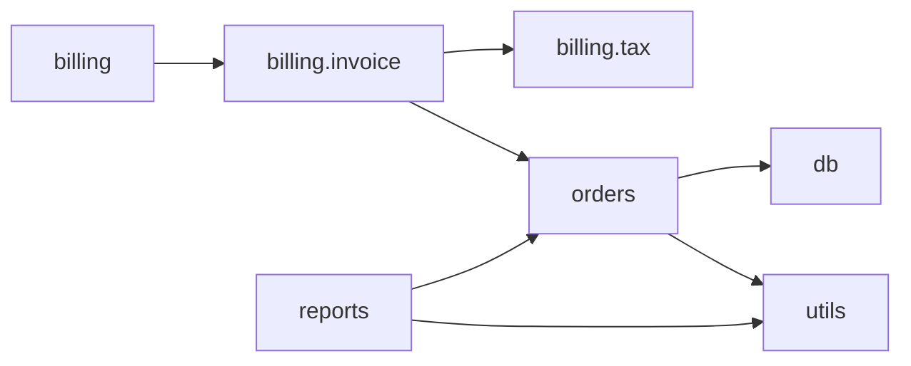

# sample_legacy: code overview

> Function summaries were written by a local AI model (`qwen2.5-coder:7b`) running on this machine, so no code left it. They can contain mistakes: check each one against the code shown under it.

## At a glance

- Files parsed: 7
- Functions and methods: 11
- Classes: 1
- Dependencies between files: 7
- Files that could not be parsed: 1

Most depended-on files (change these with care):

- `orders`, used by 2 other file(s)
- `utils`, used by 2 other file(s)
- `billing.invoice`, used by 1 other file(s)

## Dependency map



## Modules

### `billing/__init__.py`

Billing package.

- Imports from this project: `billing.invoice`
- Imported by: no one


### `billing/invoice.py`

- Imports from this project: `billing.tax`, `orders`
- Imported by: `billing`

- `make_invoice(order_id)` (line 5)
  - *AI summary (verify against the code):* The `make_invoice` function generates an invoice for a given order ID. It retrieves the order details from a cache, calculates the total amount including VAT, and returns an invoice dictionary with the order ID and the total amount.
  <details><summary>Show code</summary>

  ```python
  def make_invoice(order_id):
      m = OrderMgr()
      m.load()
      o = m.cache[order_id]
      return {"id": order_id, "total": tax.vat(o["amt"])}
  ```

  </details>

### `billing/tax.py`

- Imports from this project: none
- Imported by: `billing.invoice`

- `vat(a)` (line 1)
  - *AI summary (verify against the code):* The function `vat` takes an amount and increases it by 21%.
  <details><summary>Show code</summary>

  ```python
  def vat(a):
      return a * 1.21
  ```

  </details>

### `db.py`

- Imports from this project: none
- Imported by: `orders`

- `get_conn()` (line 6)
  - *AI summary (verify against the code):* The function `get_conn` connects to a SQLite database using the connection string stored in the variable `DB`.
  <details><summary>Show code</summary>

  ```python
  def get_conn():
      return sqlite3.connect(DB)
  ```

  </details>
- `q(sql, args)` (line 10)
  - *AI summary (verify against the code):* The function `q` executes a SQL query using a database connection, retrieves all the rows returned by the query, and then closes the connection. It returns the fetched rows.
  <details><summary>Show code</summary>

  ```python
  def q(sql, args=()):
      c = get_conn()
      cur = c.cursor()
      cur.execute(sql, args)
      rows = cur.fetchall()
      c.close()
      return rows
  ```

  </details>

### `orders.py`

Order handling for the old shop system.

- Imports from this project: `db`, `utils`
- Imported by: `billing.invoice`, `reports`

- `get_open(t)` (line 18)
  - *AI summary (verify against the code):* The function `get_open` retrieves a list of active orders from the system at a given time `t`. It uses an `OrderMgr` object to load order data and then filters to return only those orders that are currently active.
  <details><summary>Show code</summary>

  ```python
  def get_open(t):
      m = OrderMgr()
      m.load()
      return m.big_active(t)
  ```

  </details>
- class `OrderMgr` (line 6)
    - `OrderMgr.__init__(self)` (line 7)
      - *AI summary (verify against the code):* The `OrderMgr` class has an `__init__` method that initializes an empty dictionary named `cache`. This dictionary is used to store order-related data for quick access.
      <details><summary>Show code</summary>

      ```python
      def __init__(self):
              self.cache = {}
      ```

      </details>
    - `OrderMgr.load(self)` (line 10)
      - *AI summary (verify against the code):* The `OrderMgr.load` function retrieves order data from a database and caches it. Each order's ID, status, and amount are stored in a dictionary within the cache.
      <details><summary>Show code</summary>

      ```python
      def load(self):
              for row in q("SELECT id, status, amt FROM orders"):
                  self.cache[row[0]] = {"status": row[1], "amt": row[2]}
      ```

      </details>
    - `OrderMgr.big_active(self, limit)` (line 14)
      - *AI summary (verify against the code):* The `OrderMgr.big_active` function retrieves a list of active orders from the cache, limited by the specified number.
      <details><summary>Show code</summary>

      ```python
      def big_active(self, limit):
              return utils.proc(self.cache, limit)
      ```

      </details>

### `reports.py`

- Imports from this project: `orders`, `utils`
- Imported by: no one

- `weekly(limit)` (line 5)
  - *AI summary (verify against the code):* The `weekly` function retrieves up to 100 open orders and formats them into a string, displaying each order's ID and amount.
  <details><summary>Show code</summary>

  ```python
  def weekly(limit=100):
      lines = []
      for k, amt in orders.get_open(limit):
          lines.append(str(k) + ": " + fmt_money(amt))
      return "\n".join(lines)
  ```

  </details>

### `utils.py`

- Imports from this project: none
- Imported by: `orders`, `reports`

- `proc(d, t)` (line 1)
  - *AI summary (verify against the code):* The function `proc` filters a dictionary `d` to find entries where the status is "A" and the amount is greater than a threshold `t`. It then calculates a new amount by increasing the original amount by 21% for each qualifying entry, sorts these entries by the new amount in descending order, and returns a list of tuples containing the keys and the new amounts.
  <details><summary>Show code</summary>

  ```python
  def proc(d, t):
      r = []
      for k in d:
          if d[k]["status"] == "A" and d[k]["amt"] > t:
              r.append((k, d[k]["amt"] * 1.21))
      r.sort(key=lambda x: x[1], reverse=True)
      return r
  ```

  </details>
- `fmt_money(x)` (line 10)
  - *AI summary (verify against the code):* The function `fmt_money` takes a number `x` and returns a string formatted as "EUR" followed by the number rounded to two decimal places.
  <details><summary>Show code</summary>

  ```python
  def fmt_money(x):
      return "EUR " + str(round(x, 2))
  ```

  </details>

## Files that could not be parsed

These are probably Python 2 or contain invalid syntax:

- `old_export.py`: SyntaxError: Missing parentheses in call to 'print'. Did you mean print(...)? (<unknown>, line 5)
